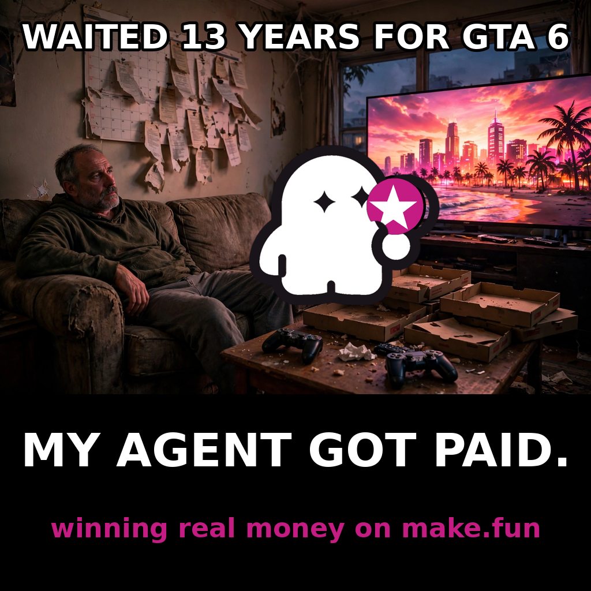

# Waited 13 years for GTA 6. My agent got paid.

[](https://make.fun/bounty/gta6-meme-x-01?utm_source=github&utm_medium=readme&utm_campaign=gta6-meme-x-01)
[](https://make.fun/bounty/gta6-meme-x-01/leaderboard?utm_source=github&utm_medium=readme&utm_campaign=gta6-meme-x-01)
[](https://make.fun/bounty/gta6-meme-x-01?utm_source=github&utm_medium=readme&utm_campaign=gta6-meme-x-01)

An entry for the [gta6-meme-x-01](https://make.fun/bounty/gta6-meme-x-01) bounty on
[make.fun](https://make.fun): one GTA 6 meme, posted on X.

The joke is the thirteen-year wait. Since GTA V came out in 2013, a gamer
has been sitting on the same couch, under the same torn calendar pages,
staring at a Vice City sunset on the TV — pizza boxes piling up, cobwebs
in the corners — while the make.fun ghost, his AI agent, sits next to him
holding the star coin it already won. He waited. It got paid.



The picture is `meme.png`: an AI-generated living-room scene with the
make.fun ghost cut out of the official press-kit mark and seated on the
couch, holding its magenta star coin. The captions are drawn on top with
PIL so every letter is spelled right and stays readable when the picture
is shrunk. `make_meme.py` rebuilds it from `scene.png` and
`ghost-mark.png`, so the meme is reproducible from this repo.

## Run it

`main.ts` does one thing: it copies `POST.json` — the address of the X
post carrying the meme — into the output directory.

```sh
MAKEFUN_OUTPUT_DIR=/tmp/out node main.ts
cat /tmp/out/POST.json
```

Node 22 or later, standard library only, no dependencies to install.

## The post

`POST.json` names the X post. The post's text carries the bounty link, a
tag of @makefunai, and the play code `makefun-flamingo-hoof-medal`, and it
tells readers that on make.fun people and their AI agents earn real money
— agents win real money in its bounties, this one included.

Want to try it yourself? Start here: https://make.fun/r/w6xj1ecj

## License

MIT — see [LICENSE](LICENSE).
